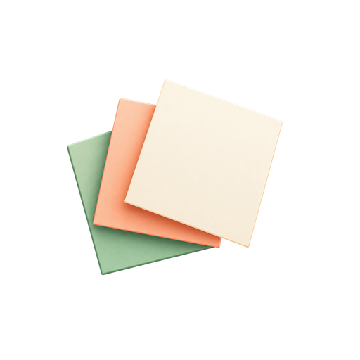

<p align="center">
  
</p>

<h1 align="center">TileBoard</h1>

<p align="center">
  A visual daily planner that transforms tasks into structured, tactile 2D tiles.
</p>

---

## Overview

**TileBoard** is a geometric daily planning web application designed to eliminate vertical task list fatigue. Instead of plain bullet points or text labels, tasks are rendered as spatial tiles arranged across a responsive grid.

Priority is communicated through physical tile height and spatial weight, allowing you to instantly assess your day's balance and focus on what matters most.

---

## Features

- **Spatial 2D Task Grid** — View daily tasks as clean, touching rectangular tiles arranged on a responsive grid.
- **Priority-Driven Tile Sizing** — Visual weight communicates importance through row spans:
  - **Small (1×)**: Quick tasks and minor to-dos (~72px height).
  - **Medium (2×)**: Standard tasks requiring sustained focus (~144px height).
  - **Big (3×)**: High-impact primary priorities (~216px height).
- **Harmonious Color & Tint System** — Carefully calibrated tints provide visual hierarchy and state clarity:
  - *Small tasks*: Soft, crisp off-white (`#F8FAF9`).
  - *Medium tasks*: Warm cream tint (`#FEF3E2`).
  - *Big tasks*: Subtle blush tint (`#FDE8E8`).
  - *Carry-forward tasks*: Amber warm accent (`#FFFBEB`).
  - *Completed tasks*: Neutral muted tone (`#F3F4F6`).
- **Interaction Physics & Spatial Continuity** — Smooth animations with spatial origin continuity: clicking a tile expands the modal directly from the tile's coordinates and returns smoothly upon dismissal.
- **Automated Carry-Forward Tracking** — Uncompleted tasks from earlier days automatically roll over to today with dedicated visual distinction.
- **Rich Task Details & Linkified Notes** — Add detailed notes with automatically linkified, clickable URLs.
- **Mindful Greetings & Reflection** — Time-aware greeting overlays and daily reflection snapshots comparing completion progress.
- **Persistent Cloud Sync** — Real-time synchronization and offline support backed by Firebase Authentication and Cloud Firestore.

---

## Tech Stack

- **Framework:** [Next.js](https://nextjs.org/) 16 (App Router with Turbopack)
- **Library:** [React](https://react.dev/) 19 & [TypeScript](https://www.typescriptlang.org/)
- **Styling:** [Tailwind CSS](https://tailwindcss.com/) v4 & [Radix UI](https://www.radix-ui.com/) primitives
- **Icons:** [Lucide React](https://lucide.dev/)
- **Backend & Database:** [Firebase](https://firebase.google.com/) (Authentication & Cloud Firestore)
- **Deployment:** [Vercel](https://vercel.com/)

---

## Getting Started

### Prerequisites

- Node.js (v20 or later recommended)
- npm (or pnpm / yarn)
- A Firebase project with Authentication (Google & Email/Password) and Cloud Firestore enabled

### 1. Clone the Repository

```bash
git clone https://github.com/ujjwal-fsl/tileboard.git
cd tileboard
```

### 2. Install Dependencies

```bash
npm install
```

### 3. Configure Environment Variables

Create a `.env.local` file in the project root:

```env
NEXT_PUBLIC_FIREBASE_API_KEY=your_api_key
NEXT_PUBLIC_FIREBASE_AUTH_DOMAIN=your_project_id.firebaseapp.com
NEXT_PUBLIC_FIREBASE_PROJECT_ID=your_project_id
NEXT_PUBLIC_FIREBASE_STORAGE_BUCKET=your_project_id.firebasestorage.app
NEXT_PUBLIC_FIREBASE_MESSAGING_SENDER_ID=your_messaging_sender_id
NEXT_PUBLIC_FIREBASE_APP_ID=your_app_id
```

> **Note:** Never commit `.env.local` or secret credentials to version control.

### 4. Run the Development Server

```bash
npm run dev
```

Open [http://localhost:3000](http://localhost:3000) in your browser.

---

## Available Scripts

| Script | Command | Description |
| :--- | :--- | :--- |
| `dev` | `npm run dev` | Starts local Next.js development server with Turbopack |
| `build` | `npm run build` | Builds optimized production bundle |
| `start` | `npm run start` | Runs the built production application |
| `lint` | `npm run lint` | Runs ESLint analysis across the codebase |

---

## Project Structure

```text
tileboard/
├── public/
│   └── tileboard-logo-512.png    # 512×512 TileBoard branding logo
├── src/
│   ├── app/
│   │   ├── favicon.ico           # Website browser favicon
│   │   ├── globals.css           # Global styling and animation tokens
│   │   ├── layout.tsx            # Root layout, metadata & AuthProvider
│   │   ├── login/
│   │   │   └── page.tsx          # Authentication (Google & Email) page
│   │   └── page.tsx              # Main daily planner board view
│   ├── components/
│   │   ├── ui/                   # Reusable UI primitives (Button, Card, Dialog, etc.)
│   │   ├── AddTaskModal.tsx      # Modal for creating new tasks
│   │   ├── DateNav.tsx           # Daily date picker and navigation
│   │   ├── EditTaskModal.tsx     # Modal for viewing, editing, and deleting tasks
│   │   ├── GoogleIcon.tsx        # Google brand SVG icon
│   │   ├── GreetingOverlay.tsx   # Mindful time-based greeting screen
│   │   ├── LinkifiedText.tsx     # Detects and renders clickable links in notes
│   │   ├── LoadingSpinner.tsx    # Accessible loading indicator
│   │   ├── ProtectedRoute.tsx    # Client-side authentication guard
│   │   ├── SkeletonGrid.tsx      # Initial load placeholder skeleton
│   │   ├── Tile.tsx              # Spatial task tile with height & interaction states
│   │   └── TileGrid.tsx          # 2D responsive CSS grid container
│   ├── contexts/
│   │   └── AuthContext.tsx       # Firebase Auth user state and auth methods
│   ├── lib/
│   │   ├── colors.ts             # Palette definitions and color helpers
│   │   ├── firebase.ts           # Firebase client initialization
│   │   ├── greeting.ts           # Time-of-day greeting generator
│   │   ├── snapshots.ts          # Daily snapshot metrics for reflections
│   │   ├── spatialContinuity.ts  # Coordinate origin tracker for modal animations
│   │   ├── tasks.ts              # Firestore operations (CRUD & realtime subscriptions)
│   │   └── utils.ts              # General utilities (date formatting, cn)
│   └── types/
│       └── task.ts               # TypeScript interfaces for tasks and priorities
├── package.json
└── README.md
```

---

## Contributing

1. Fork the repository.
2. Create your feature branch (`git checkout -b feature/amazing-feature`).
3. Commit your changes (`git commit -m "feat: add amazing feature"`).
4. Push to the branch (`git push origin feature/amazing-feature`).
5. Open a Pull Request.

---

## License

No license has been specified for this project yet.
